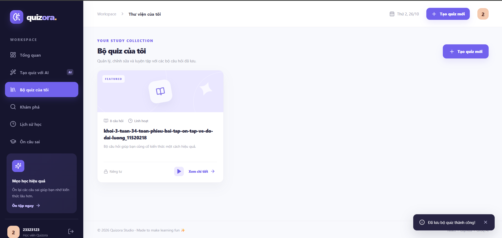
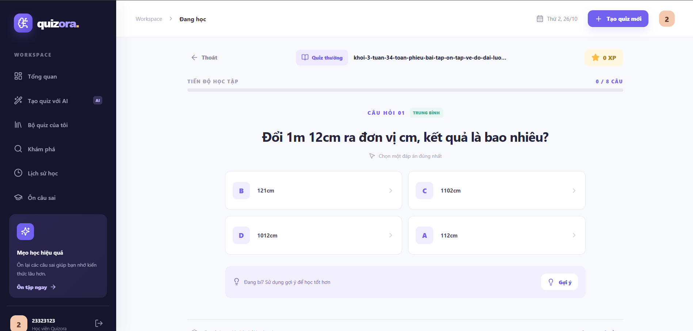

# 🎓 SMARTQUIZ STUDIO – NỀN TẢNG HỌC TẬP VÀ TẠO TRẮC NGHIỆM THÔNG MINH BẰNG AI

## 1. Giới thiệu dự án

**SmartQuiz Studio** là ứng dụng web hỗ trợ học tập và ôn luyện kiến thức thông qua hệ thống câu hỏi trắc nghiệm thông minh, kết hợp công nghệ trí tuệ nhân tạo (AI).

Dự án được xây dựng nhằm giải quyết những khó khăn trong việc tạo câu hỏi, tổ chức nội dung ôn tập và đánh giá kết quả học tập. Thay vì phải tự soạn từng câu hỏi, người dùng có thể cung cấp nội dung tài liệu để hệ thống AI tự động tạo bộ câu hỏi trắc nghiệm.

Ngoài phương pháp làm bài truyền thống, SmartQuiz Studio tích hợp nhiều chế độ trò chơi tương tác, giúp quá trình ôn luyện trở nên sinh động, thú vị và hiệu quả hơn.

**Mục tiêu của dự án:**

- Ứng dụng AI vào quá trình tạo và quản lý câu hỏi trắc nghiệm.
- Tiết kiệm thời gian chuẩn bị nội dung học tập.
- Cung cấp nhiều hình thức ôn luyện kiến thức.
- Theo dõi kết quả và tiến độ học tập của người dùng.
- Xây dựng nền tảng học tập có giao diện trực quan, dễ sử dụng.

## 2. Công nghệ sử dụng

| Thành phần         | Công nghệ                 |
| ------------------ | ------------------------- |
| Frontend           | ReactJS, Vite, JavaScript |
| Backend            | Node.js, Express.js       |
| Cơ sở dữ liệu      | SQLite                    |
| Trí tuệ nhân tạo   | Groq API                  |
| Xác thực           | JWT                       |
| Giao diện          | CSS, Lucide Icons         |
| Công cụ phát triển | Visual Studio Code        |
| Quản lý mã nguồn   | Git, GitHub               |

Hệ thống được xây dựng theo mô hình Client – Server. Frontend đảm nhiệm việc hiển thị giao diện và tương tác với người dùng, trong khi Backend xử lý nghiệp vụ, quản lý dữ liệu và kết nối với dịch vụ AI.

## 3. Các chức năng chính

### 3.1. Đăng ký và đăng nhập tài khoản

Hệ thống cung cấp chức năng đăng ký, đăng nhập và quản lý phiên làm việc, giúp mỗi người dùng có một không gian học tập riêng.

Người dùng có thể tạo tài khoản bằng thông tin cá nhân, đăng nhập để sử dụng các tính năng và lưu trữ dữ liệu học tập trên hệ thống.

**Các chức năng:**

- Đăng ký tài khoản mới.
- Đăng nhập bằng email và mật khẩu.
- Xác thực người dùng bằng JWT.
- Đăng xuất khỏi hệ thống.
- Bảo vệ dữ liệu học tập cá nhân.

**[CHÈN ẢNH 1: GIAO DIỆN ĐĂNG KÝ VÀ ĐĂNG NHẬP]**
.png>)

### 3.2. Trang tổng quan (Dashboard)

Sau khi đăng nhập, người dùng được chuyển đến trang tổng quan với các thông tin cơ bản về hoạt động học tập.

Trang này giúp người dùng nhanh chóng theo dõi tình hình học tập, truy cập các bộ câu hỏi và tiếp tục quá trình ôn luyện.

**Các chức năng:**

- Hiển thị thông tin tổng quan học tập.
- Thống kê số lượng bộ câu hỏi.
- Hiển thị hoạt động học tập.
- Truy cập nhanh các bộ quiz.
- Điều hướng đến những chức năng quan trọng.

**[CHÈN ẢNH 2: GIAO DIỆN TRANG TỔNG QUAN]**
.png>)

### 3.3. Tạo câu hỏi trắc nghiệm tự động bằng AI

Đây là một trong những chức năng quan trọng nhất của SmartQuiz Studio.

Hệ thống tích hợp Groq API nhằm hỗ trợ người dùng tự động tạo bộ câu hỏi trắc nghiệm từ nội dung học tập được cung cấp.

Người dùng có thể nhập văn bản hoặc tải tài liệu lên hệ thống. Sau khi xử lý, AI sẽ phân tích nội dung và tạo các câu hỏi phục vụ quá trình ôn luyện.

**Các chức năng:**

- Tạo câu hỏi từ văn bản nhập trực tiếp.
- Hỗ trợ tài liệu TXT, DOCX và PDF có lớp văn bản.
- Hỗ trợ nhận diện nội dung từ ảnh thông qua AI Vision.
- Tự động xây dựng bộ câu hỏi dựa trên tài liệu.
- Cho phép người dùng xem và chỉnh sửa câu hỏi sau khi tạo.

**[CHÈN ẢNH 3: GIAO DIỆN TẠO QUIZ BẰNG AI]**
.png>)

### 3.4. Quản lý bộ câu hỏi

SmartQuiz Studio cho phép người dùng quản lý các bộ câu hỏi đã tạo trong thư viện cá nhân.

Mỗi bộ quiz gồm danh sách câu hỏi và những thông tin liên quan, giúp người dùng tổ chức nội dung học tập theo chủ đề.

**Các chức năng:**

- Xem danh sách bộ câu hỏi.
- Xem chi tiết từng bộ quiz.
- Chỉnh sửa nội dung câu hỏi.
- Xóa bộ câu hỏi không còn cần thiết.
- Thiết lập chế độ công khai hoặc riêng tư.
- Truy cập và làm lại các bộ quiz.

**[CHÈN ẢNH 4: GIAO DIỆN THƯ VIỆN VÀ QUẢN LÝ QUIZ]**

## 4. Năm chế độ học tập và trò chơi

SmartQuiz Studio cung cấp 5 chế độ học tập khác nhau, giúp người dùng lựa chọn hình thức ôn luyện phù hợp với sở thích và mục tiêu.

### 4.1. Quiz thường (Classic Quiz)

Đây là hình thức học tập truyền thống, trong đó người dùng lần lượt trả lời các câu hỏi trắc nghiệm.

Chế độ này phù hợp với việc ôn tập kiến thức, củng cố lý thuyết và kiểm tra mức độ ghi nhớ nội dung.

**[CHÈN ẢNH 5: CHẾ ĐỘ QUIZ THƯỜNG]**

### 4.2. Trò chơi Bắn gà (Chicken Game)

Chế độ Bắn gà kết hợp kiến thức trắc nghiệm với yếu tố trò chơi, giúp tăng sự hứng thú trong quá trình học tập.

Người chơi lựa chọn đáp án thông qua các thao tác tương tác, tạo cảm giác vừa học vừa giải trí thay vì chỉ đọc và trả lời câu hỏi theo cách thông thường.

**[CHÈN ẢNH 6: TRÒ CHƠI BẮN GÀ]**
scripts/img/anh6.png

### 4.3. Ai là triệu phú (Millionaire)

Chế độ này được xây dựng dựa trên ý tưởng trò chơi kiến thức Ai là triệu phú.

Người chơi trả lời các câu hỏi theo từng mốc thử thách, qua đó kiểm tra sự hiểu biết và khả năng vận dụng kiến thức.

**[CHÈN ẢNH 7: TRÒ CHƠI AI LÀ TRIỆU PHÚ]**
scripts/img/anh7.png

### 4.4. Đua 60 giây (Speed Race)

Đây là chế độ luyện tập có giới hạn thời gian, yêu cầu người chơi tập trung và đưa ra đáp án nhanh chóng.

Chức năng hướng đến việc rèn luyện phản xạ, khả năng ghi nhớ và tốc độ xử lý câu hỏi.

**[CHÈN ẢNH 8: CHẾ ĐỘ ĐUA 60 GIÂY]**
scripts/img/anh8.png

### 4.5. Ghép thẻ (Matching Game)

Chế độ Ghép thẻ cho phép người dùng luyện tập kiến thức thông qua hoạt động tìm và ghép các cặp nội dung có liên quan với nhau.

Hình thức này giúp người học củng cố kiến thức bằng phương pháp ghi nhớ trực quan.

**[CHÈN ẢNH 9: TRÒ CHƠI GHÉP THẺ]**
scripts/img/anh9.png

## 5. Chấm điểm và xem kết quả

Sau khi hoàn thành bài luyện tập, hệ thống thực hiện đánh giá kết quả dựa trên câu trả lời của người dùng.

Các thông tin kết quả giúp người học xác định mức độ nắm vững kiến thức, nhận biết những nội dung cần cải thiện và lựa chọn phương pháp ôn tập phù hợp.

**Các chức năng:**

- Tự động chấm điểm bài làm.
- Hiển thị kết quả sau khi hoàn thành.
- Theo dõi số câu trả lời đúng và sai.
- Hỗ trợ xem lại quá trình làm bài.
- Lưu kết quả phục vụ việc theo dõi học tập.

**[CHÈN ẢNH 10: GIAO DIỆN KẾT QUẢ LÀM BÀI]**
scripts/img/anh10.png

## 6. Lịch sử học tập và Flashcard

Hệ thống lưu lại lịch sử làm bài để người dùng có thể xem lại quá trình học tập của bản thân.

Ngoài ra, SmartQuiz Studio hỗ trợ chức năng ôn tập các câu trả lời sai bằng Flashcard, giúp người dùng tập trung củng cố những kiến thức chưa nắm chắc.

**Các chức năng:**

- Xem lịch sử làm bài.
- Theo dõi kết quả học tập.
- Xem lại các câu hỏi đã trả lời sai.
- Sử dụng Flashcard để ôn tập.
- Hỗ trợ cải thiện khả năng ghi nhớ kiến thức.

**[CHÈN ẢNH 11: LỊCH SỬ HỌC TẬP]**
scripts/img/anh11.png
**[CHÈN ẢNH 12: GIAO DIỆN FLASHCARD]**
scripts/img/anh12.png

## 7. Khám phá và chia sẻ bộ câu hỏi

Bên cạnh việc tạo các bộ câu hỏi cá nhân, SmartQuiz Studio còn hỗ trợ khả năng khám phá nội dung học tập được chia sẻ.

Người dùng có thể lựa chọn công khai bộ quiz để người khác truy cập và tham gia luyện tập.

Tính năng này góp phần xây dựng môi trường học tập có tính tương tác và chia sẻ kiến thức.

**Các chức năng:**

- Khám phá các bộ quiz công khai.
- Truy cập nội dung học tập được chia sẻ.
- Quản lý quyền riêng tư của bộ câu hỏi.
- Tham gia luyện tập với bộ quiz có sẵn.
- Theo dõi bảng xếp hạng học tập.

## 8. Kiến trúc hệ thống

SmartQuiz Studio được tổ chức thành hai thành phần chính:

**Frontend – ReactJS:** Chịu trách nhiệm xây dựng giao diện người dùng, hiển thị dữ liệu, quản lý trạng thái và gửi yêu cầu đến API.

**Backend – Node.js và Express:** Xử lý xác thực, quản lý bộ câu hỏi, lưu trữ kết quả học tập và giao tiếp với Groq API.

**Database – SQLite:** Lưu trữ thông tin tài khoản, dữ liệu quiz và lịch sử làm bài.

**AI Service – Groq:** Tiếp nhận nội dung do Backend gửi đến và hỗ trợ sinh câu hỏi trắc nghiệm từ tài liệu.

Quy trình xử lý cơ bản:

**Người dùng → ReactJS → Express API → SQLite / Groq AI → Trả kết quả → Hiển thị trên giao diện.**

## 9. Hướng dẫn cài đặt và chạy dự án

### Yêu cầu hệ thống

- Máy tính có cài đặt Node.js phiên bản 22.13 trở lên.
- Visual Studio Code hoặc trình soạn thảo mã nguồn tương đương.
- Trình duyệt web hiện đại.
- Kết nối Internet để sử dụng các chức năng AI.
- Groq API Key để tạo câu hỏi bằng AI.

### Bước 1: Tải mã nguồn

Repository GitHub:

https://github.com/DucHackerlor/SmartQuiz-Studio

Sử dụng Git để tải mã nguồn hoặc chọn **Code → Download ZIP** trên GitHub.

### Bước 2: Mở dự án

Mở thư mục `SmartQuiz_Studio` trong Visual Studio Code.

### Bước 3: Cài đặt thư viện

Mở Terminal tại thư mục chứa `package.json` và chạy:

`npm install`

### Bước 4: Cấu hình API Key

Tạo API Key tại:

https://console.groq.com/keys

Sử dụng script `1_CAI_DAT_GROQ.bat` để thiết lập cấu hình trên Windows hoặc cấu hình biến môi trường theo hướng dẫn của dự án.

API Key được lưu tại Backend và không được đưa lên GitHub.

### Bước 5: Khởi động hệ thống

Chạy:

`npm run dev`

Sau khi khởi động thành công, truy cập:

**Frontend:** http://localhost:5173

**Backend API:** http://localhost:3000/api/health

### Bước 6: Kiểm tra hoạt động của AI

Chạy lệnh:

`npm run ai:check`

Chức năng này hỗ trợ kiểm tra khả năng kết nối với dịch vụ AI đã cấu hình.

## 10. Kiểm thử và bảo mật

Dự án được tổ chức với các thành phần hỗ trợ kiểm thử API, kiểm thử xử lý kết quả và kiểm tra tích hợp AI.

Một số biện pháp bảo mật được áp dụng bao gồm xác thực JWT, kiểm tra dữ liệu đầu vào và quản lý API Key qua biến môi trường.

Các thông tin nhạy cảm như API Key, cơ sở dữ liệu cá nhân và tệp cấu hình `.env` không được đưa vào mã nguồn công khai.

## 11. Hạn chế và hướng phát triển

### Hạn chế hiện tại

- Chất lượng câu hỏi AI phụ thuộc vào nội dung tài liệu đầu vào.
- Groq API miễn phí có giới hạn về số lần gọi và lượng token.
- Tài liệu PDF dạng ảnh quét cần chuyển sang định dạng ảnh phù hợp để xử lý qua Vision.
- Hiệu quả thực tế cần được đánh giá thông qua quá trình sử dụng và kiểm thử.

### Hướng phát triển

- Nâng cao chất lượng câu hỏi do AI tạo ra.
- Mở rộng các hình thức học tập tương tác.
- Phát triển hệ thống phân tích và thống kê tiến độ học tập.
- Tối ưu giao diện trên thiết bị di động.
- Cải thiện khả năng xử lý tài liệu.
- Triển khai hệ thống lên môi trường trực tuyến.

## 12. Kết luận

SmartQuiz Studio là một ứng dụng web kết hợp công nghệ trí tuệ nhân tạo với phương pháp học tập tương tác nhằm hỗ trợ người dùng ôn luyện kiến thức hiệu quả.

Dự án không chỉ tập trung vào việc tạo câu hỏi trắc nghiệm tự động mà còn xây dựng một môi trường học tập đa dạng thông qua các trò chơi, hệ thống chấm điểm, lịch sử học tập và Flashcard.

Thông qua quá trình xây dựng hệ thống, dự án vận dụng những kiến thức về lập trình Frontend, Backend, REST API, quản lý cơ sở dữ liệu, xác thực người dùng và tích hợp dịch vụ AI.

**SmartQuiz Studio – Học thông minh, luyện tập thú vị và chinh phục kiến thức cùng AI.**

---

**Thông tin dự án**

- **Tên đề tài:** SmartQuiz Studio
- **Môn học:** Lập trình Web nâng cao.
- **Repository:** https://github.com/DucHackerlor/SmartQuiz-Studio
- **Nhóm thực hiện:** Nhóm 15
- **Thành viên:**
  24100430 Nguyễn Minh Đức
  24100312 Tô Quý Đạt
  24100475 Nguyễn Thành Đô
